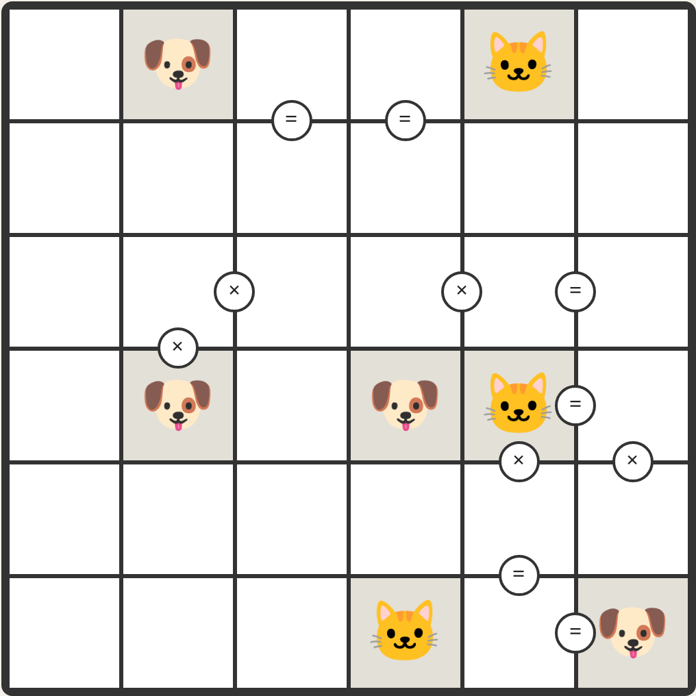

# Tango (LinkedIn-style puzzle)

Browser version of the **Tango** puzzle on a 6×6 grid, with **all possible 11 222 valid
boards** in three difficulty levels (easy, medium, hard). Every start opens a random board.

## Rules

- Fill every cell with 🐱 or 🐶.
- No more than 2 identical symbols may be adjacent, in a row or a column.
- Every row and column contains exactly 3 of each symbol.
- `=` between two cells means they hold the **same** symbol; `×` means **different**.
- The puzzle has exactly one solution.
- The "no two identical rows/columns" rule of the original game is ignored.

## How to play

**Playing**

- Click a cell to cycle: empty → 🐱 → 🐶 → empty.
- Gray cells are given and locked.
- A cell that breaks a rule turns red after one second without a new move.
- When the grid is complete and valid, confetti falls and the stopwatch stops
  ("Solved in 1 min 23 sec"). **Next board →** opens another random unsolved board.

**Buttons**

- **Easy / Medium / Hard:** pick a level; easy has the most clues, hard the fewest. An easy
  puzzle can be solved with the simple rules alone; medium and hard puzzles may also need the try-a-symbol step.
- **💡 Hint:** fills in one cell that the rules settle and locks it. A light-yellow note says why.
  The cell is highlighted.
  A cell you filled wrongly is corrected first. The note disappears on your next move.
- **↶ Undo:** takes back the last move. **Reset:** clears the board back to the start.
- **✨ Solve:** fills in the whole solution and stops the stopwatch. It counts as giving up.
  Use **Reset** to play the board again.
- **⏸ Pause / ▶ Resume:** freezes the stopwatch and blurs the board.
- **ⓘ** (top-right): explains the rules.

**Choosing a board**

- **☰** (top-left) opens the list of all boards for the current level. The 11 222 boards are
  grouped in three layers: thousands (1–1 000, ...), hundreds (1–100, ...) and then the
  board numbers. A range tile fills with green as you solve its boards. Click a number to
  play that board.
- **🎲 Random** picks a random unsolved board; **Go to #** jumps to a board number.
- Solved boards are remembered per level in the browser's `localStorage`.
- The address shows the open board, for example `#hard/123` (level and board number). Reloading the
  page, or sharing the link, opens the same board; an address that is not a real board is ignored
  and a random board is picked. The moves you made are not saved, so a reload starts the board
  from its given cells.

## Example board

Board 1 on the easy level, as the game starts and when solved. How the data is stored and
decoded is explained at the top of [`scripts/generate-puzzles.mjs`](scripts/generate-puzzles.mjs).

| Start                                                    | Solved                                              |
| -------------------------------------------------------- | --------------------------------------------------- |
|  |  |

## Tech stack

- **Node.js 26**: the JavaScript runtime that runs the development tools (Vite, TypeScript)
  on your computer; the game itself runs in the browser.
- **npm**: the package manager that comes with Node.js and installs the tools listed in
  `package.json`.
- **TypeScript**: JavaScript with static types, so mistakes such as a misspelled property
  are caught by the compiler.
- **Vite**: a development server that reloads the page when you save a file, and a build tool
  that bundles the project into static files.
- **Vanilla DOM**: the page is built with the browser's own DOM API, with no UI framework.

## Getting started

### 1. Install Node.js and npm

npm is installed together with Node.js. The project needs **Node 26**.

- **Installer:** download Node.js 26 from <https://nodejs.org> and run it.
- **Version manager (recommended):** [nvm](https://github.com/nvm-sh/nvm)

  ```bash
  nvm install 26
  nvm use 26
  ```

### 2. Install the dependencies and start the game

```bash
npm install
npm run dev
```

Then open the address Vite prints (by default <http://localhost:5173>).

### 3. Commands

| Command                 | What it does                                                                                                                       | When to use it                                                                        |
| ----------------------- | ---------------------------------------------------------------------------------------------------------------------------------- | ------------------------------------------------------------------------------------- |
| `npm install`           | Downloads every dependency listed in `package.json` into `node_modules/` and updates `package-lock.json` if needed.                | Once after cloning, and after changing dependencies.                                  |
| `npm ci`                | Installs exactly the versions in `package-lock.json`, deletes `node_modules/` first and never modifies the lock file.              | Clean, reproducible installs (also the right choice when the lock file is read-only). |
| `npm run dev`           | Starts the Vite development server with hot reload: the page updates whenever you save a source file. Stop it with `Ctrl+C`.       | While developing.                                                                     |
| `npm test`              | Runs every unit test once with Vitest and exits.                                                                                   | Before every commit and pull request.                                                 |
| `npm run test:coverage` | Runs the tests and prints a coverage report; fails when coverage is below 90%. DOM-only files are excluded (see `vite.config.ts`). | Before a pull request.                                                                |

## Project structure

```
linkedin-tango/
├── .run/
│   └── dev.run.xml       WebStorm run configuration that starts `npm run dev`
├── example/
│   ├── example_start_board.png   board 1 (easy) at the start
│   └── example_solved_board.png  board 1 solved
├── public/
│   ├── favicon.svg           the browser-tab icon (a cat and a dog)
│   ├── apple-touch-icon.png  the same icon as a 180×180 PNG for iOS home screens
│   ├── icon-192.png, icon-512.png, icon-maskable-512.png  the icon for installing the game as an app
│   └── manifest.webmanifest  the app name, colours and icons used when the game is installed
├── scripts/
│   ├── generate-puzzles.mjs  generates src/data (all boards and their puzzles)
│   ├── clue-index.mjs        ClueIndex class: counts the boards that fit a set of clues
│   └── deduction-solver.mjs  solves a puzzle with the steps of the hint button (simple rules, then
│                             try-a-symbol) to tell which puzzles the hint can explain to the end
├── src/
│   ├── main.ts               entry point: creates the GamePage and starts it
│   ├── style.css             base styling
│   ├── game/                 the game model and its rules, no DOM
│   │   ├── board-constants.ts  board size and the counting rules
│   │   ├── symbols.ts        the cat and dog symbols and the click cycle
│   │   ├── cell-position.ts  CellPosition, GivenCell, cell keys and the list of all cell positions
│   │   ├── board.ts          Board class: the grid of cells
│   │   ├── line.ts           Line: a row or a column, and helpers to walk along it
│   │   ├── edge-hint.ts      EdgeHint class: an "=" or "×" between two cells
│   │   ├── rules.ts          rule checking functions: which cells break a rule, is the board solved
│   │   ├── solution.ts       Solution: the one correct way to fill the board, and functions that use it
│   │   ├── puzzle.ts         Puzzle: given cells, edge hints and the solution of one board
│   │   ├── board-address.ts  BoardAddress: reads and writes the open board in the page address (#hard/123)
│   │   ├── puzzle-library.ts PuzzleLibrary class: decodes puzzles from src/data and picks the next board
│   │   ├── puzzle-game.ts    PuzzleGame class: one puzzle being played (clicks, undo, hint, solve)
│   │   ├── difficulty.ts     the difficulty levels and their labels
│   │   ├── history.ts        ChangeHistory class: change history used by the undo button
│   │   └── solved-boards.ts  SolvedBoards class: solved boards per level (localStorage)
│   ├── hints/                the hint button
│   │   ├── hint.ts           Hint and findHint(): picks the cell for the hint button
│   │   ├── deduction.ts      Deduction and DeductionKind: a cell that has to hold a symbol, and which rule says so
│   │   ├── hint-deductions.ts  the simple rules that settle a cell (signs, pairs, sandwiches, full lines)
│   │   ├── hint-lookahead.ts   the fallback: assume a symbol and look for a broken rule
│   │   ├── hint-explanation.ts the sentence and the related cells shown for each kind of rule
│   │   ├── hint-note-view.ts HintNoteView class: shows the explanation beside the board
│   │   └── hint-note.css     the light-yellow note beside the board and the hint highlights
│   ├── board-menu/           the boards drawer
│   │   ├── board-menu.ts     BoardMenu class: the boards (thousands, hundreds, numbers)
│   │   ├── board-ranges.ts   splitting the boards into ranges and counting solved ones
│   │   ├── menu-drawer.ts    MenuDrawer class: opens and closes the drawer
│   │   └── board-menu.css    styling of the boards drawer
│   ├── ui/                   the page: board, buttons, timer
│   │   ├── game-page.ts      GamePage class: connects the page to the game, the stopwatch and the progress
│   │   ├── board-view.ts     BoardView class: builds the DOM for the board and positions the hints
│   │   ├── difficulty-picker.ts  DifficultyPicker class: difficulty buttons
│   │   ├── stopwatch.ts      Stopwatch class
│   │   ├── timer-display.ts  TimerDisplay class: shows the stopwatch time
│   │   ├── info-dialog.ts    InfoDialog class: the "how to play" dialog
│   │   ├── start-paw.ts      the paw that walks in and taps the ⓘ button when the page opens (skipped with reduced motion)
│   │   ├── paw-path.ts       where the paw stops and which way its toes point
│   │   ├── required-element.ts  finds an element of index.html or fails with a clear message
│   │   ├── controls.css      styling of the difficulty and undo/reset buttons
│   │   ├── start-paw.css     the paw's walk-in animation
│   │   ├── panel.css         layout of the title, timer, side buttons and info dialog
│   │   └── error-highlight.css  1-second CSS delay before rule violations turn red
│   ├── offline/              offline play
│   │   ├── service-worker.template.js  the service worker; the build fills in its file list and version
│   │   ├── service-worker-source.ts  fills in the template and lists the files to store
│   │   └── register-service-worker.ts  starts the service worker in the production build
│   ├── effects/              the celebration when a puzzle is solved
│   │   ├── confetti.ts       Confetti class: the confetti animation
│   │   ├── success-sound.ts  SuccessSound class: plays the success sound
│   │   └── assets/success.wav  the success sound
│   ├── test-support/         helpers shared by the tests (a board from text, a fake localStorage, a fake service worker scope)
│   ├── utils/                stateless helpers
│   │   ├── format-number.ts  writes 11222 as "11 222"
│   │   └── format-duration.ts  writes 83 seconds as "1 min 23 sec"
│   │   (every `<name>.test.ts` file sits next to the `<name>.ts` file it tests)
│   └── data/                 generated: boards.json (all boards) and easy/medium/hard.json (one puzzle per board)
├── .gitattributes        marks package-lock.json as a generated file
├── .gitignore            files Git ignores: node_modules, dist, .idea/
├── .npmrc                npm settings: enforce the Node version
├── .nvmrc                Node version for nvm (26)
├── CLAUDE.md             code style and workflow rules (also read by Claude Code)
├── README.md             this file
├── index.html            the page: loads src/main.ts and holds the board, buttons and menu
├── package-lock.json     exact dependency versions, generated by npm (do not edit)
├── package.json          project metadata, npm scripts, Node version, dependencies
├── tsconfig.json         TypeScript compiler settings (strict mode)
├── vite-plugins/
│   └── offline-plugin.ts     writes dist/service-worker.js after every build
└── vite.config.ts        Vite configuration (see below)
```

### Deployment: live game and test build

Two workflows publish to the `gh-pages` branch, which GitHub Pages serves
(Settings > Pages > Source: Deploy from a branch > `gh-pages` / root):

| Address                                           | Built from                                                                                                                             | Workflow                            |
| ------------------------------------------------- | -------------------------------------------------------------------------------------------------------------------------------------- | ----------------------------------- |
| `https://wielkate.github.io/linkedin-tango/`      | `master`, on every push                                                                                                                | `.github/workflows/deploy.yml`      |
| `https://wielkate.github.io/linkedin-tango/test/` | a pull request from this repository (every push to it), or any branch started by hand under Actions > Deploy test build > Run workflow | `.github/workflows/deploy-test.yml` |

There is one test site: the newest test build replaces the previous one. Both sites share one
origin, so they share `localStorage` (solved boards and times). Their offline caches are kept
apart because the cache name contains the site folder.

### Offline play

After the game has been opened once, it opens again without a network, and it can be installed
from the browser menu ("Install" or "Add to Home Screen"). Progress is already kept in
`localStorage`, so solved boards and times stay as they are.
