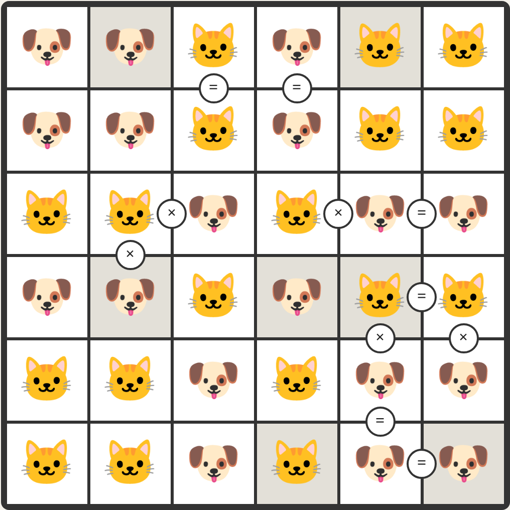

# Tango (LinkedIn-style puzzle)

A minimal browser version of the **Tango** puzzle on a 6×6 grid, with **all 11 222 valid
boards** in three difficulty levels (easy, medium, hard). Every start opens a random board.

## Rules

- Fill every cell with 🐱 or 🐶.
- No more than 2 identical symbols may be adjacent, in a row or a column.
- Every row and column contains exactly 3 of each symbol.
- `=` between two cells means they hold the **same** symbol; `×` means **different**.
- The puzzle has exactly one solution.
- The "no two identical rows/columns" rule of the original game is intentionally **not** applied.

## How to play

**Playing**

- Click a cell to cycle: empty → 🐱 → 🐶 → empty.
- Grey cells are given and locked.
- A cell that breaks a rule turns red after one second without a new move.
- When the grid is complete and valid, confetti falls and the stopwatch stops
  ("Solved in 1 min 23 sec"). **Next board →** opens another random unsolved board.

**Buttons**

- **Easy / Medium / Hard:** pick a level; easy has the most clues, hard the fewest.
- **↶ Undo:** takes back the last move. **Reset:** clears the board back to the given cells.
- **💡 Hint:** fills in one cell that the rules settle and locks it. A light-yellow note beside the board
  (under it on a narrow screen) says why, in order of difficulty: an `=` / `×` sign next to a filled cell,
  two identical symbols side by side, a cell between two identical symbols, or a row or column that
  already holds its three of a kind. When none of those applies it tries a symbol and explains that it
  leads to a broken rule. The cell is highlighted and the cells the note talks about are outlined.
  A cell you filled wrongly is corrected first. The note disappears on your next move.
- **✨ Solve:** fills in the whole solution. The board then counts as solved, with the confetti,
  the sound and the board saved as solved, so use it only when you want to give up.
- **⏸ Pause / ▶ Resume:** freezes the stopwatch and blurs the board.
- **ⓘ** (top-right): explains the rules, pauses the stopwatch and blurs the board while it is open
  (also on a solved board).

**Choosing a board**

- **☰** (top-left) opens the list of all boards for the current level. The 11 222 boards are
  grouped in three layers: thousands (1–1 000, ...), hundreds (1–100, ...) and then the
  board numbers. A range tile fills with green as you solve its boards. Click a number to
  play that board.
- **🎲 Random** picks a random unsolved board; **Go to #** jumps to a board number.
- Solved boards are remembered per level in the browser's `localStorage`.

## Example board

Board 1 on the easy level, as the game starts and when solved. How the data is stored and
decoded is explained at the top of [`scripts/generate-puzzles.mjs`](scripts/generate-puzzles.mjs).

| Start                                                    | Solved                                              |
| -------------------------------------------------------- | --------------------------------------------------- |
|  |  |

## Tech stack

- **Node.js 26**: the JavaScript runtime that runs the development tools (Vite, TypeScript)
  on your computer; the game itself runs in the browser.
- **npm**: the package manager that comes with Node.js and installs the tools listed in
  `package.json`.
- **TypeScript**: JavaScript with static types, so mistakes such as a misspelled property
  are caught by the compiler before the game runs.
- **Vite**: a development server that reloads the page when you save a file, and a build tool
  that bundles the project into static files.
- **Vanilla DOM**: the page is built with the browser's own DOM API, with no UI framework.

## Getting started

### 1. Install Node.js and npm

npm is installed together with Node.js. The project needs **Node 26**.

- **Installer:** download Node.js 26 from <https://nodejs.org> and run it.
- **Version manager (recommended):** [nvm](https://github.com/nvm-sh/nvm) on macOS/Linux or
  [nvm-windows](https://github.com/coreybutler/nvm-windows) on Windows lets you switch Node
  versions per project:

  ```bash
  nvm install 26
  nvm use 26
  ```

Check the installation:

```bash
node --version   # must print v26.x.x
npm --version
```

Node 26 is enforced in three places, so a wrong version is caught early:

- `package.json` → `"engines": { "node": "26.x" }` declares the required version.
- `.npmrc` → `engine-strict=true` makes `npm install` fail on any other version.
- `.nvmrc` → tells nvm which version to use (`nvm use` without arguments).

### 2. Install the dependencies and start the game

```bash
npm install
npm run dev
```

Then open the address Vite prints (by default <http://localhost:5173>).

### 3. Commands

| Command           | What it does                                                                                                                                                            | When to use it                                                                        |
| ----------------- | ----------------------------------------------------------------------------------------------------------------------------------------------------------------------- | ------------------------------------------------------------------------------------- |
| `npm install`     | Downloads every dependency listed in `package.json` into `node_modules/` and updates `package-lock.json` if needed.                                                     | Once after cloning, and after changing dependencies.                                  |
| `npm ci`          | Installs exactly the versions in `package-lock.json`, deletes `node_modules/` first and never modifies the lock file.                                                   | Clean, reproducible installs (also the right choice when the lock file is read-only). |
| `npm run dev`     | Starts the Vite development server with hot reload: the page updates whenever you save a source file. Stop it with `Ctrl+C`.                                            | While developing.                                                                     |
| `npm run build`   | First runs `tsc --noEmit` (type-checks all code and writes no files, so type errors stop the build), then `vite build` (bundles the game into static files in `dist/`). | Before publishing, and to check that the types are correct.                           |
| `npm run preview` | Serves the already built `dist/` folder locally (by default <http://localhost:4173>), exactly as a static host would.                                                   | After `npm run build`, to test the production build.                                  |

## Run in WebStorm

1. Open the project folder in WebStorm.
2. Make sure WebStorm uses Node 26: **Settings → Languages & Frameworks → Node.js → Node interpreter**.
3. Run `npm install` once (WebStorm offers this in a banner when it opens `package.json`).
4. Pick the **dev** run configuration in the run widget at the top right and press ▶.

The **dev** configuration is shared through the repository in `.run/dev.run.xml`; it runs `npm run dev`; every saved change appears in the browser (styles update in place, code changes reload the page).

## Project structure

```
linkedin-tango/
├── .run/
│   └── dev.run.xml       WebStorm run configuration that starts `npm run dev`
├── example/
│   ├── example_start_board.png   board 1 (easy) at the start
│   └── example_solved_board.png  board 1 solved
├── public/
│   ├── favicon.svg           the browser-tab icon (a cat and a dog)
│   └── apple-touch-icon.png  the same icon as a 180×180 PNG for iOS home screens
├── scripts/
│   ├── generate-puzzles.mjs  generates src/data (all boards and their puzzles)
│   ├── clue-index.mjs        ClueIndex class: counts the boards that fit a set of clues
│   └── format-json.mjs       writes JSON arrays with one element per line
├── src/
│   ├── main.ts               entry point: creates the GamePage and starts it
│   ├── style.css             base styling
│   ├── game/                 the game model and its rules, no DOM
│   │   ├── board-constants.ts  board size and the counting rules
│   │   ├── symbols.ts        the cat and dog symbols and the click cycle
│   │   ├── cell-position.ts  CellPosition, GivenCell, cell keys and the list of all cell positions
│   │   ├── board.ts          Board class: the grid of cells
│   │   ├── line.ts           Line: a row or a column, and helpers to walk along it
│   │   ├── edge-hint.ts      EdgeHint class: an "=" or "×" between two cells
│   │   ├── rules.ts          rule checking functions: which cells break a rule, is the board solved
│   │   ├── solution.ts       Solution: the one correct way to fill the board, and functions that use it
│   │   ├── puzzle.ts         Puzzle: given cells, edge hints and the solution of one board
│   │   ├── puzzle-library.ts PuzzleLibrary class: decodes puzzles from src/data and picks the next board
│   │   ├── puzzle-game.ts    PuzzleGame class: one puzzle being played (clicks, undo, hint, solve)
│   │   ├── difficulty.ts     the difficulty levels and their labels
│   │   ├── history.ts        ChangeHistory class: change history used by the undo button
│   │   └── solved-boards.ts  SolvedBoards class: solved boards per level (localStorage)
│   ├── hints/                the hint button
│   │   ├── hint.ts           Hint and findHint(): picks the cell for the hint button
│   │   ├── deduction.ts      Deduction and DeductionKind: a cell that has to hold a symbol, and which rule says so
│   │   ├── hint-deductions.ts  the simple rules that settle a cell (signs, pairs, sandwiches, full lines)
│   │   ├── hint-lookahead.ts   the fallback: assume a symbol and look for a broken rule
│   │   ├── hint-explanation.ts the sentence and the related cells shown for each kind of rule
│   │   ├── hint-note-view.ts HintNoteView class: shows the explanation beside the board
│   │   └── hint-note.css     the light-yellow note beside the board and the hint highlights
│   ├── board-menu/           the boards drawer
│   │   ├── board-menu.ts     BoardMenu class: the boards (thousands, hundreds, numbers)
│   │   ├── board-ranges.ts   splitting the boards into ranges and counting solved ones
│   │   ├── menu-drawer.ts    MenuDrawer class: opens and closes the drawer
│   │   └── board-menu.css    styling of the boards drawer
│   ├── ui/                   the page: board, buttons, timer
│   │   ├── game-page.ts      GamePage class: connects the page to the game, the stopwatch and the progress
│   │   ├── board-view.ts     BoardView class: builds the DOM for the board and positions the hints
│   │   ├── difficulty-picker.ts  DifficultyPicker class: difficulty buttons
│   │   ├── stopwatch.ts      Stopwatch class
│   │   ├── timer-display.ts  TimerDisplay class: shows the stopwatch time
│   │   ├── info-dialog.ts    InfoDialog class: the "how to play" dialog
│   │   ├── required-element.ts  finds an element of index.html or fails with a clear message
│   │   ├── controls.css      styling of the difficulty and undo/reset buttons
│   │   ├── panel.css         layout of the title, timer, side buttons and info dialog
│   │   └── error-highlight.css  1-second CSS delay before rule violations turn red
│   ├── effects/              the celebration when a puzzle is solved
│   │   ├── confetti.ts       Confetti class: the confetti animation
│   │   ├── success-sound.ts  SuccessSound class: plays the success sound
│   │   └── assets/success.wav  the success sound
│   ├── utils/                stateless helpers
│   │   ├── format-number.ts  writes 11222 as "11 222"
│   │   └── format-duration.ts  writes 83 seconds as "1 min 23 sec"
│   └── data/                 generated: boards.json (all boards) and easy/medium/hard.json (one puzzle per board)
├── .gitattributes        marks package-lock.json as a generated file
├── .gitignore            files Git ignores: node_modules, dist, .idea/
├── .npmrc                npm settings: enforce the Node version
├── .nvmrc                Node version for nvm (26)
├── CLAUDE.md             code style and workflow rules (also read by Claude Code)
├── README.md             this file
├── index.html            the page: loads src/main.ts and holds the board, buttons and menu
├── package-lock.json     exact dependency versions, generated by npm (do not edit)
├── package.json          project metadata, npm scripts, Node version, dependencies
├── tsconfig.json         TypeScript compiler settings (strict mode)
└── vite.config.ts        Vite configuration (see below)
```

### `vite.config.ts`

Vite reads this file whenever you run `npm run dev`, `npm run build` or `npm run preview`.
It contains one setting, `base: './'`, which makes every asset URL in the built `index.html`
relative (`./assets/...`) instead of absolute (`/assets/...`).

GitHub Pages serves a project site from `https://<user>.github.io/<repo-name>/`. With absolute
URLs the browser would look for the files at `https://<user>.github.io/assets/...` and fail.
With a relative base, the same `dist/` folder works under any path. Everything else uses
Vite's defaults (dev server on port 5173, build output in `dist/`).

### Generated files

`package-lock.json` is generated by npm. Do not edit it by hand: change `package.json` and run
`npm install`, and the changes will be written to the lock file. Git cannot store a read-only
flag, so the file is marked as generated in `.gitattributes` (GitHub collapses it in diffs).
To protect your own copy, make it read-only, and make it writable again when you add a
dependency:

```bash
chmod 444 package-lock.json   # read-only
chmod 644 package-lock.json   # writable again
```

## Code style

The rules are in [CLAUDE.md](CLAUDE.md): braces on every loop and condition, no one-line
conditions, meaningful names, small single-purpose functions, named conditions, one class per
file, JSON arrays with one element per line, and a linear git history.

## Roadmap

1. ~~Generate all 11 222 valid boards and store them as static data~~ (done)
2. ~~Solver + puzzle generator with unique-solution check~~ (done, see `scripts/generate-puzzles.mjs`)
3. ~~Progress tracking (`localStorage`) and timer~~ (done)
4. GitHub Pages deployment via GitHub Actions
